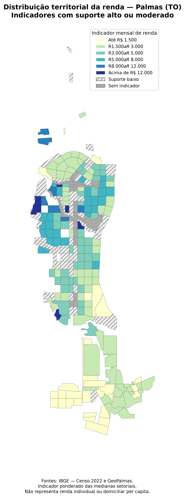
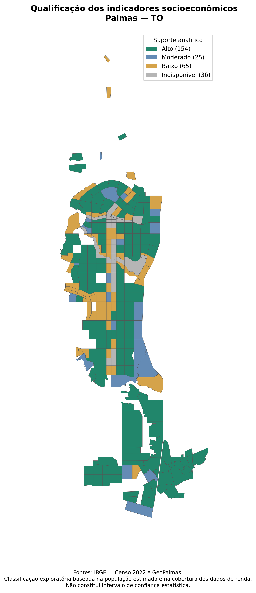
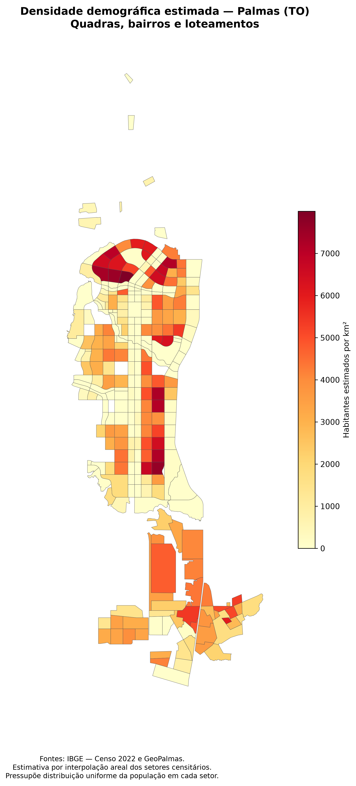

# Metodologia geoespacial — Palmas/TO

**Responsável:** Kenneth Wanderson Pereira Veras
**Projeto:** Sistema de Inteligência Tributária — Sprint 05
**Referência dos indicadores:** Censo Demográfico 2022

## 1. Objetivo

Construir indicadores territoriais exploratórios de renda e densidade para subsidiar a análise de impactos sociais. O enriquecimento é complementar à E3 e não determina elegibilidade ao IPTU Social, nem constitui uma carteira de contribuintes ou teste de fairness individual.

## 2. Fontes

- [IBGE — agregados básicos por setores censitários](https://ftp.ibge.gov.br/Censos/Censo_Demografico_2022/Agregados_por_Setores_Censitarios/Agregados_por_Setor_csv/Agregados_por_setores_basico_BR_20260520.zip).
- [IBGE — rendimento das pessoas responsáveis](https://ftp.ibge.gov.br/Censos/Censo_Demografico_2022/Agregados_por_Setores_Censitarios_Rendimento_do_Responsavel/Agregados_por_setores_renda_responsavel_BR_20260508_csv.zip).
- [Dicionário de rendimento](https://ftp.ibge.gov.br/Censos/Censo_Demografico_2022/Agregados_por_Setores_Censitarios_Rendimento_do_Responsavel/dicionario_de_dados_renda_responsavel_20260508.xlsx).
- [Malha censitária do Tocantins](https://ftp.ibge.gov.br/Censos/Censo_Demografico_2022/Agregados_por_Setores_Censitarios/malha_com_atributos/setores/gpkg/UF/TO/TO_setores_CD2022.gpkg).
- [GeoPalmas](https://geo.palmas.to.gov.br/mapas/): delimitações municipais de quadras, loteamentos e outras áreas.

A extração do GeoPalmas apresentou problema de validação TLS. Foi utilizado acesso diagnóstico sem verificação do certificado para dados públicos; a autenticidade da origem não foi confirmada criptograficamente nessa etapa. Recomenda-se repetir a coleta com cadeia de certificados válida antes de uso oficial.

## 3. Preparação censitária

Filtragem pelo código municipal 1721000 e integração por código de setor, preservado como texto. A base consolidada contém 733 setores, população de 302.692 habitantes, 660 setores com indicadores de rendimento, 50 sem população e 23 setores povoados sem rendimento disponível. Ausência de rendimento não foi convertida em zero.

As variáveis V06004 e V06006 representam, respectivamente, média e mediana do rendimento nominal mensal das pessoas responsáveis com rendimento em domicílios particulares permanentes ocupados. Não representam renda domiciliar per capita. V06001 representa pessoas responsáveis e V06002, moradores desse universo.

## 4. Tratamento espacial

A malha censitária apresentou 734 feições para 733 setores de Palmas. Um setor com duas geometrias foi consolidado por dissolução, preservando atributos sem duplicar população. No GeoPalmas foram obtidos 284 registros, dos quais 283 tinham geometria válida; a consolidação de geometrias idênticas resultou em 280 áreas. Divergências de nomenclatura foram preservadas como ressalvas, não resolvidas por presunção.

A união espacial das áreas corresponde a aproximadamente 114,06 km². Permaneceram pequenas sobreposições residuais, tratadas na ponderação. As operações métricas foram realizadas em SIRGAS 2000 / UTM zona 22S (EPSG:31982).

## 5. Interseção e interpolação areal

A interseção entre as áreas municipais e os setores produziu 1.624 fragmentos, abrangendo 280 áreas e 676 setores. A cobertura geométrica das áreas municipais pelos setores foi aproximadamente integral, dentro da precisão numérica.

Para cada fragmento entre área i e setor j, calcula-se:

- `f_ij = area_intersecao_ij / area_setor_j`
- `w_ij = f_ij / max(1, soma_i(f_ij))`
- `populacao_estimada_i = soma_j(w_ij * populacao_j)`

A correção evita alocar mais de 100% da população de um setor devido a sobreposições. Setores parcialmente cobertos não são reescalados para cobertura integral. A mesma ponderação é aplicada aos totais de responsáveis e moradores disponíveis. A hipótese de distribuição uniforme no setor é uma aproximação, não uma contagem observada por quadra.

## 6. Indicadores de rendimento e suporte

Os indicadores de renda são médias ponderadas das médias e das medianas setoriais, utilizando o número estimado de responsáveis como peso, apenas nos fragmentos com informação disponível. Esse peso é uma aproximação: o total de responsáveis não equivale necessariamente ao número de responsáveis com rendimento. A média ponderada de medianas não é a mediana real da área.

A densidade demográfica estimada corresponde à população interpolada dividida pela área em km². A cobertura populacional de rendimento corresponde à proporção da população estimada situada em fragmentos com dados de rendimento, não à proporção de pessoas que recebem renda.

| Suporte analítico | Critério exploratório |
|---|---|
| Alto | Indicador disponível, população estimada >= 100 e cobertura populacional >= 95% |
| Moderado | Indicador disponível, população estimada >= 30 e cobertura >= 80%, sem enquadramento em Alto |
| Baixo | Indicador disponível, demais casos |
| Indisponível | Indicador ausente |

Os limiares são decisões metodológicas exploratórias, não intervalos de confiança nem medidas de precisão estatística validadas.

## 7. Resultados

| Indicador | Resultado |
|---|---:|
| Setores censitários consolidados | 733 |
| Áreas municipais consolidadas | 280 |
| Fragmentos de interseção | 1.624 |
| Áreas com indicador de rendimento | 244 (87,14%) |
| População estimada nas áreas | 262.239,14 |
| Proporção da população municipal estimada nas áreas | 86,64% |
| Suporte alto | 154 (55,00%) |
| Suporte moderado | 25 (8,93%) |
| Suporte baixo | 65 (23,21%) |
| Indisponível | 36 (12,86%) |

A cobertura territorial da base GeoPalmas utilizada não corresponde à totalidade do município. A diferença populacional não pode ser atribuída automaticamente à zona rural.

## 8. Produtos e reprodução

Scripts de integração e análise:

- `src/governance/integracao_territorial.py`
- `src/governance/indicadores_territoriais.py`
- `src/governance/mapas_territoriais.py`

Produtos intermediários e finais em `data/processed/` incluem `base_censitaria_palmas_2022.csv`, `palmas_setores_socioeconomicos_2022.gpkg`, `palmas_areas_consolidadas.gpkg`, `intersecoes_geopalmas_ibge.gpkg`, `indicadores_territoriais_palmas_2022.csv`, `indicadores_territoriais_qualificados.csv` e `palmas_areas_socioeconomicas_qualificadas.gpkg`. A reprodução requer os insumos preparados nas etapas anteriores, além de pandas, GeoPandas e Matplotlib. A automatização integral da coleta inicial não foi demonstrada.

### Mapas

## 9. Limitações éticas e metodológicas

A interpolação uniforme pode atribuir população a parques e áreas comerciais. Os limites municipais e censitários podem apresentar diferenças temporais e geométricas. Os rendimentos são nominais de 2022 e não representam a situação individual em 2026. A ausência de dados não significa ausência de renda.

É vedado inferir elegibilidade individual, condição socioeconômica pessoal ou prioridade de cobrança a partir da localização territorial. Tal inferência configuraria risco de falácia ecológica e discriminação por proxy. Não há vinculação validada entre inscrições em dívida ativa e setores censitários, nem dados de desfechos reais para avaliar equidade individual.

Os resultados devem ser utilizados exclusivamente como contexto territorial exploratório para o RIA e planejamento de análises futuras, mantendo a decisão tributária dependente de fontes administrativas oficiais e revisão humana.
