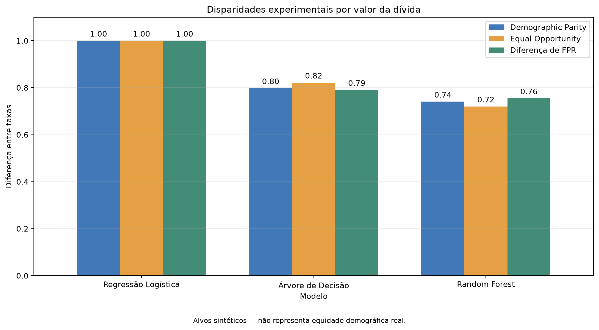
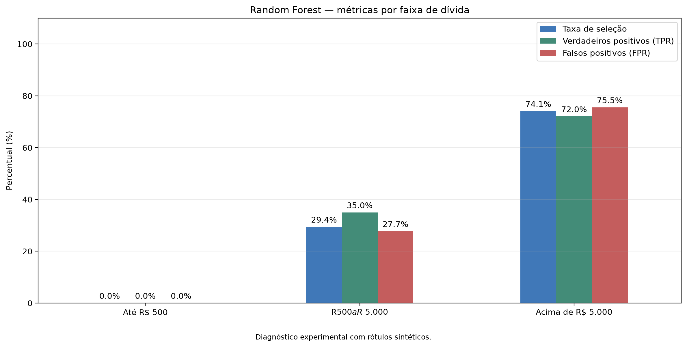
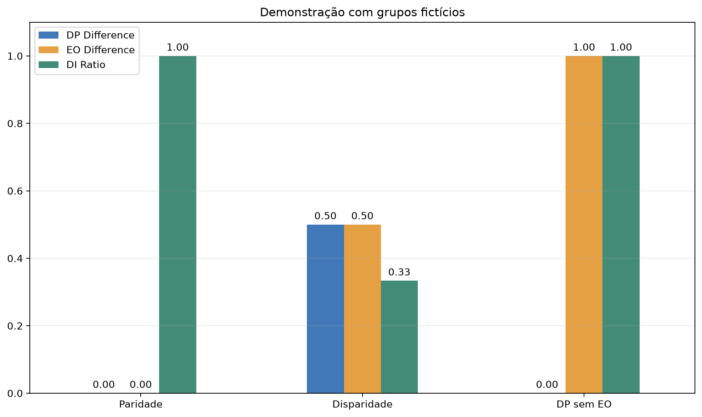
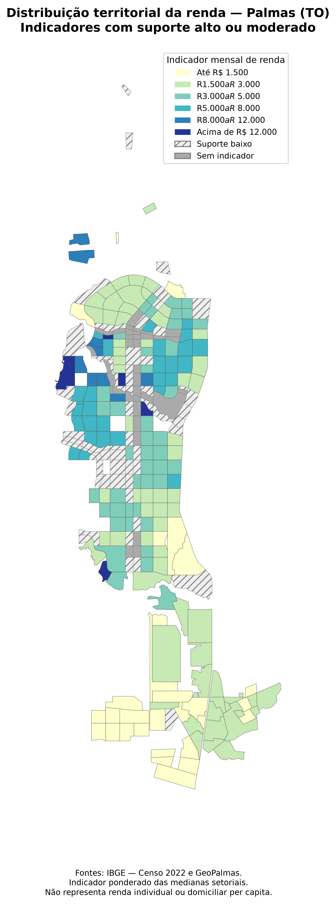
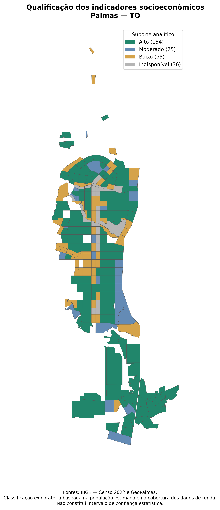
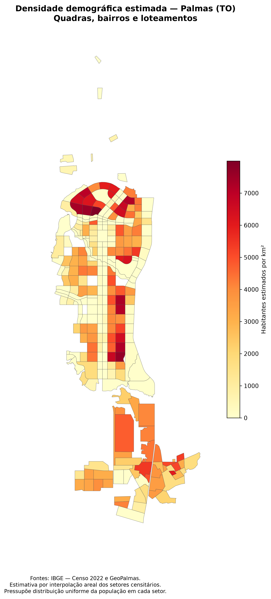

# Relatório de Impacto Algorítmico — Fairness

**Projeto:** Sistema de Inteligência Tributária — Palmas/TO\
**Instituição:** Universidade Federal do Tocantins (UFT)\
**Curso:** Bacharelado Interdisciplinar em Inteligência Artificial\
**Responsável:** Arthur Felipe\
**Sprint:** 05\
**Data:** 24/11/2026\

## 1. Introdução

Este documento apresenta a avaliação experimental de equidade
algorítmica (fairness) dos modelos de classificação desenvolvidos
na Sprint 04 do Sistema de Inteligência Tributária.

O objetivo é identificar disparidades no comportamento dos modelos,
investigar possíveis riscos de discriminação e estabelecer
recomendações para uma utilização responsável da inteligência
artificial no contexto da dívida ativa municipal.

A análise possui caráter exploratório e acadêmico. Não constitui
validação de equidade demográfica real, autorização de cobrança
tributária ou certificação de conformidade jurídica.

## 2. Fundamentação teórica

Fairness em sistemas de inteligência artificial refere-se à análise
e mitigação de desigualdades potencialmente prejudiciais produzidas
por decisões algorítmicas.

A avaliação de um sistema não deve considerar exclusivamente
indicadores tradicionais de desempenho, como acurácia, precisão
e F1-score. Modelos com desempenho global semelhante podem
apresentar comportamentos substancialmente diferentes entre grupos.

Neste trabalho foram implementadas cinco métricas de disparidade.

### 2.1. Demographic Parity

Compara as taxas de classificação positiva entre grupos.

DP Difference = max(SR_g) - min(SR_g)

Em que:

SR_g = (TP + FP) / N

O valor zero representa igualdade nas taxas de seleção dos grupos
avaliados, sem necessariamente implicar justiça substantiva.

### 2.2. Equal Opportunity

Compara as taxas de verdadeiros positivos entre grupos.

EO Difference = max(TPR_g) - min(TPR_g)

Em que:

TPR_g = TP / (TP + FN)

O valor zero indica igualdade nas taxas de verdadeiros positivos.

A interpretação depende da disponibilidade de rótulos confiáveis.
Neste projeto, os rótulos são sintéticos e não representam
desfechos administrativos observados.

### 2.3. Disparate Impact

Compara proporcionalmente as taxas de seleção.

DI Ratio = min(SR_g) / max(SR_g)

O valor 1 representa igualdade proporcional entre taxas de
seleção. O valor zero representa a existência de pelo menos
um grupo sem classificações positivas, quando outro grupo
apresenta classificações positivas.

Quando todas as taxas de seleção são zero, a razão é indefinida.

A métrica não constitui, isoladamente, comprovação de
discriminação ou conformidade jurídica.

### 2.4. False Positive Rate Difference

Compara as taxas de falsos positivos entre grupos.

FPR = FP / (FP + TN)

FPR Difference = max(FPR_g) - min(FPR_g)

Em um eventual contexto de cobrança, classificações positivas
incorretas poderiam contribuir para intervenções indevidas,
caso fossem utilizadas sem controles administrativos.

### 2.5. False Negative Rate Difference

Compara as taxas de falsos negativos entre grupos.

FNR = FN / (FN + TP)

FNR Difference = max(FNR_g) - min(FNR_g)

Na classificação binária, a diferença de FNR corresponde
matematicamente à diferença de TPR, quando ambas estão definidas.

### 2.6. Tratamento de métricas indefinidas

Quando não existem observações suficientes para calcular uma
taxa, o sistema retorna um valor ausente (None/null).

Essa abordagem evita interpretar ausência de informação como
ausência de disparidade.

## 3. Metodologia experimental

Foram reutilizados os artefatos produzidos na Sprint 04:

- Regressão Logística;
- Árvore de Decisão;
- Random Forest de inadimplência proxy;
- Random Forest de recuperabilidade proxy.

Os modelos foram avaliados sem retreinamento.

As variáveis utilizadas são:

- log_valor_divida;
- idade_divida_dias.

A preparação dos dados reproduziu o procedimento do notebook
da Sprint 04, incluindo a geração dos alvos sintéticos e a
divisão temporal.

Foi utilizada exclusivamente a partição de teste posterior
a 30/06/2026, preservando a semente aleatória 42 e a data
de referência de 01/10/2026.

### 3.1. Caracterização da amostra

| Indicador | Resultado |
|---|---:|
| Registros válidos | 38.557 |
| Registros de teste | 11.048 |
| Semente aleatória | 42 |
| Matrizes originais reproduzidas | Sim |
| Retreinamento dos modelos | Não |

A unidade de análise corresponde a registros de dívida,
não necessariamente a contribuintes distintos.

### 3.2. Subgrupos analisados

| Faixa de valor da dívida | Registros |
|---|---:|
| Até R$ 500 | 7.296 |
| Acima de R$ 500 até R$ 5.000 | 3.409 |
| Acima de R$ 5.000 | 343 |
| Total | 11.048 |

| Idade da dívida | Registros |
|---|---:|
| Até 30 dias | 2 |
| 31 a 60 dias | 0 |
| Acima de 60 dias | 11.046 |

As faixas representam características financeiras e temporais
dos registros, não atributos demográficos dos indivíduos.

A análise utiliza as fórmulas de fairness como instrumentos
de diagnóstico de disparidades entre subgrupos.

Para o modelo multiclasse de recuperabilidade, foi utilizada
a estratégia de uma classe contra as demais (one-versus-rest).

## 4. Resultados experimentais

### 4.1. Comparação por valor da dívida

| Modelo | DP Difference | EO Difference | DI Ratio | FPR Difference |
|---|---:|---:|---:|---:|
| Regressão Logística | 1,0000 | 1,0000 | 0,0000 | 1,0000 |
| Árvore de Decisão | 0,7980 | 0,8217 | 0,0039 | 0,7907 |
| RF Inadimplência | 0,7405 | 0,7203 | 0,0000 | 0,7550 |
| Recuperabilidade baixa | 0,5131 | N/D | 0,0000 | 0,4201 |
| Recuperabilidade média | 0,5131 | 0,4201 | 0,4869 | N/D |
| Recuperabilidade alta | 0,2470 | N/D | 0,0000 | 0,0000 |

N/D: métrica não definida.



O Random Forest de inadimplência apresentou diferenças menores
de DP e EO que os dois baselines.

Entretanto, esse resultado não permite concluir que o modelo
seja socialmente mais justo. As métricas são condicionadas aos
alvos sintéticos e aos subgrupos analisados.

Além disso, os grupos de valor e idade são derivados das mesmas
variáveis utilizadas na modelagem. As disparidades observadas
podem refletir tanto o comportamento dos classificadores quanto
as regras de construção dos próprios alvos sintéticos.

### 4.2. Random Forest de inadimplência

| Faixa de dívida | N | Seleção | TPR | FPR | Acurácia |
|---|---:|---:|---:|---:|---:|
| Até R$ 500 | 7.296 | 0,00% | 0,00% | 0,00% | 88,14% |
| Acima de R$ 500 até R$ 5.000 | 3.409 | 29,39% | 34,97% | 27,70% | 63,60% |
| Acima de R$ 5.000 | 343 | 74,05% | 72,03% | 75,50% | 44,31% |



O modelo não atribuiu classificação positiva a nenhum registro
com valor de dívida de até R$ 500, embora existam 865 exemplos
positivos segundo o alvo sintético nessa faixa.

Na faixa superior a R$ 5.000, foram observadas taxas elevadas
de classificação positiva e de falsos positivos.

O resultado evidencia forte disparidade experimental associada
ao valor da dívida e reforça a necessidade de investigar os
critérios de classificação antes de eventual aplicação real.

A classificação positiva representa exclusivamente a classe
experimental de inadimplência proxy, não uma ordem de cobrança.

### 4.3. Limitações dos grupos temporais

A distribuição da idade das dívidas apresenta forte
desequilíbrio amostral.

A faixa de até 30 dias possui apenas dois registros, enquanto
a faixa intermediária não apresenta observações.

Consequentemente, diferenças entre grupos temporais não
constituem evidência estatística robusta.

As métricas indefinidas foram preservadas como valores ausentes,
e as métricas numericamente calculáveis devem ser interpretadas
com cautela devido ao tamanho reduzido dos grupos.

## 5. Cenários integralmente sintéticos

Para demonstrar o funcionamento das métricas independentemente
dos modelos existentes, foram construídos três cenários
controlados com grupos fictícios A e B.

Cada cenário contém oito observações, quatro por grupo.

| Cenário | DP | EO | DI |
|---|---:|---:|---:|
| Paridade | 0,0000 | 0,0000 | 1,0000 |
| Disparidade | 0,5000 | 0,5000 | 0,3333 |
| Paridade de seleção sem EO | 0,0000 | 1,0000 | 1,0000 |



No segundo cenário, ambos os grupos apresentam acurácia de 75%,
apesar das diferenças nas métricas de equidade.

No terceiro cenário, os grupos apresentam a mesma taxa de
seleção, mas taxas de verdadeiros positivos completamente
distintas.

Esses exemplos demonstram que:

- Acurácia semelhante não implica equidade entre grupos.
- Demographic Parity não garante Equal Opportunity.
- Uma única métrica não é suficiente para avaliar justiça.
- Diferentes critérios de fairness podem produzir conclusões
  distintas sobre o mesmo conjunto de classificações.

Os grupos fictícios não representam pessoas, faixas de renda,
raça, gênero, bairros ou contribuintes reais.

## 6. Contexto socioeconômico de Palmas

A análise territorial produzida na Sprint 05 integrou dados
do Censo Demográfico 2022 do IBGE e geometrias do GeoPalmas.

A metodologia está documentada em
[metodologia_geoespacial.md](metodologia_geoespacial.md).

| Indicador territorial | Resultado |
|---|---:|
| Setores censitários | 733 |
| Áreas municipais analisadas | 280 |
| Fragmentos de interseção | 1.624 |
| Áreas com indicador de rendimento | 244 |
| Áreas com suporte alto ou moderado | 179 |
| Áreas com suporte baixo ou indisponível | 101 |
| Proporção estimada da população municipal | 86,64% |

### 6.1. Distribuição territorial do rendimento



A distribuição espacial dos indicadores de rendimento evidencia
heterogeneidade socioeconômica no território municipal.

Entretanto, os indicadores correspondem ao rendimento das
pessoas responsáveis por domicílios, conforme a definição
censitária utilizada, e não à renda individual de cada
contribuinte ou à renda domiciliar per capita.

O indicador territorial não pode ser utilizado para presumir
capacidade de pagamento, inadimplência ou elegibilidade ao
IPTU Social.

### 6.2. Suporte analítico territorial



| Suporte | Áreas | Proporção |
|---|---:|---:|
| Alto | 154 | 55,00% |
| Moderado | 25 | 8,93% |
| Baixo | 65 | 23,21% |
| Indisponível | 36 | 12,86% |

A existência de áreas com suporte reduzido ou indisponível
evidencia limitações na cobertura informacional.

Os níveis de suporte são critérios metodológicos exploratórios
e não representam intervalos de confiança validados.

### 6.3. Densidade demográfica



A distribuição da densidade demográfica permite contextualizar
a concentração populacional e possíveis impactos territoriais
de políticas públicas.

O indicador resulta de interpolação areal e não representa
uma contagem populacional diretamente observada por área.

### 6.4. Falácia ecológica e discriminação por proxy

A falácia ecológica ocorre quando características agregadas
de uma população são indevidamente atribuídas aos indivíduos
que pertencem a essa população.

No contexto deste projeto, residir em uma área de menor
rendimento médio não significa necessariamente possuir
baixa renda individual.

A utilização inadequada de localização geográfica também
poderia funcionar como proxy de atributos socioeconômicos
ou demográficos, produzindo discriminação indireta.

Não existe correspondência individual validada entre os
registros de dívida ativa e os dados censitários.

Por esse motivo, os indicadores territoriais não foram
utilizados como atributos individuais nos cálculos das
métricas de fairness.

## 7. Proteção ao IPTU Social

A Sprint 05 incorporou uma camada determinística de governança
independente das classificações dos modelos de ML.

A implementação está descrita em
[protecao_iptu_social.md](protecao_iptu_social.md).

| Situação administrativa | Decisão de governança |
|---|---|
| Benefício oficialmente reconhecido | Bloquear |
| Dados ausentes, inválidos ou não verificados | Revisão humana |
| Possível elegibilidade ou situação pendente | Revisão humana |
| Não elegibilidade oficialmente verificada e demais requisitos atendidos | Prosseguir para controles adicionais |

A decisão de prosseguimento não constitui autorização
automática de cobrança.

Na ausência de informações suficientes, a política mantém
uma abordagem fail-closed, impedindo a interpretação de
resultados experimentais como autorização administrativa.

Os 106 testes automatizados da camada de proteção foram
reproduzidos com sucesso no ambiente utilizado nesta análise.

Essa evidência demonstra o funcionamento dos casos testados,
mas não comprova conformidade jurídica integral, segurança
absoluta ou funcionamento operacional com o provedor real.

## 8. Matriz de riscos algorítmicos

| Risco | Consequência potencial | Mitigação recomendada |
|---|---|---|
| Discriminação territorial | Tratamento desigual baseado em localização | Não utilizar indicadores agregados para decisões individuais |
| Falácia ecológica | Inferência incorreta da renda pessoal | Exigir informações administrativas verificadas |
| Alvos sintéticos | Classificações sem validade preditiva real | Obter desfechos administrativos observados |
| Desequilíbrio amostral | Métricas instáveis entre subgrupos | Exigir amostras adequadas e análise de incerteza |
| Falsos positivos | Possíveis intervenções indevidas | Revisão humana e controles de governança |
| Dados cadastrais insuficientes | Falha na identificação de beneficiários | Aplicar política fail-closed |
| Dependência excessiva do modelo | Automatização de decisões prejudiciais | Impedir decisões exclusivamente algorítmicas |
| Desatualização dos indicadores | Interpretação incorreta da situação atual | Atualizar e verificar as fontes |
| Qualidade desigual dos dados | Resultados pouco representativos | Monitorar cobertura e qualidade informacional |

Os riscos apresentados são potenciais. A análise não comprova
que tais impactos estejam ocorrendo na administração municipal.

## 9. Validação automatizada

Foi desenvolvido o módulo src/governance/fairness.py, contendo
as funções de cálculo e validação das métricas.

Os testes abrangem:

- Cenários de paridade e disparidade;
- Matrizes de confusão;
- Grupos únicos e múltiplos;
- Ausência de exemplos positivos ou negativos;
- Ausência de classificações positivas;
- Entradas inválidas;
- Amostras vazias;
- Divisão por zero;
- Reprodutibilidade.

| Indicador | Resultado |
|---|---:|
| Testes de Fairness | 27 |
| Testes aprovados | 27 |
| Falhas | 0 |
| Instruções cobertas | 39/39 |
| Ramificações cobertas | 16/16 |
| Cobertura do módulo fairness.py | 100% |

Considerando as suítes de proteção ao IPTU Social e Fairness,
foram registrados 133 testes aprovados em execuções separadas.

A cobertura refere-se ao módulo testado e não representa
cobertura integral do sistema ou comprovação de justiça
algorítmica.

## 10. Reprodutibilidade

Ambiente utilizado:

| Componente | Versão |
|---|---|
| Python | 3.12.10 |
| Pandas | 3.1.1 |
| NumPy | 2.5.5 |
| Scikit-learn | 1.8.0 |

Na raiz do repositório, com as dependências instaladas:

```bash
python -m pip install pytest pytest-cov
python -m pytest tests/test_fairness.py -v
python -m src.analysis.fairness_experimento
python -m src.analysis.fairness_evidencias
```

Para reprodução do notebook:

```bash
python -m pip install ipykernel nbformat nbconvert
python -m nbconvert --to notebook --execute --inplace notebooks/sprint05_fairness.ipynb --ExecutePreprocessor.timeout=600
```

### Evidências

- [Notebook da Sprint 05](../notebooks/sprint05_fairness.ipynb)
- [Módulo de Fairness](../src/governance/fairness.py)
- [Script experimental](../src/analysis/fairness_experimento.py)
- [Geração de evidências](../src/analysis/fairness_evidencias.py)
- [Testes automatizados](../tests/test_fairness.py)
- [Métricas dos modelos](evidencias/fairness/metricas_modelos_proxy.json)
- [Métricas por subgrupo](evidencias/fairness/metricas_por_subgrupo.csv)
- [Cenários sintéticos](evidencias/fairness/cenarios_sinteticos.json)
- [Relatório de testes](evidencias/fairness/relatorio_testes.txt)
- [Cobertura XML](evidencias/fairness/cobertura.xml)
- [Cobertura HTML](evidencias/fairness/cobertura/index.html)

## 11. Recomendações de mitigação

Para uma eventual evolução do protótipo, recomenda-se:

1. Obter dados reais e confiáveis de desfechos administrativos.

2. Definir a finalidade de cada classificação e avaliar
   suas possíveis consequências para os contribuintes.

3. Realizar análises de fairness com atributos individuais
   somente quando houver finalidade legítima, necessidade,
   fundamento jurídico e controles adequados de proteção.

4. Estabelecer critérios mínimos de suporte amostral e
   medidas de incerteza para comparação entre grupos.

5. Monitorar diferenças nas taxas de seleção, falsos positivos
   e falsos negativos.

6. Investigar possíveis variáveis proxy de atributos
   socioeconômicos e demográficos.

7. Preservar a independência da camada de proteção ao IPTU
   Social em relação aos modelos de inteligência artificial.

8. Garantir revisão humana, rastreabilidade, possibilidade
   de contestação e mecanismos de correção.

9. Realizar validação jurídica e funcional antes de qualquer
   utilização administrativa.

10. Monitorar continuamente mudanças na distribuição dos
    dados e possíveis impactos desproporcionais.

## 12. Limitações

Os resultados devem ser interpretados considerando que:

- Os alvos são sintéticos e não representam inadimplência
  ou recuperação efetivamente observadas.
- Os atributos utilizados não identificam grupos demográficos.
- Os registros de dívida não representam necessariamente
  contribuintes distintos.
- A base não permite verificar individualmente a elegibilidade
  ao IPTU Social.
- Não existe vinculação individual validada com o Censo.
- Os indicadores territoriais apresentam limitações de
  cobertura, interpolação e atualização temporal.
- A autenticidade criptográfica da origem dos dados GeoPalmas
  não foi confirmada durante a extração diagnóstica reportada.
- Os grupos temporais são altamente desequilibrados.
- Não foram estimados intervalos de confiança das disparidades.
- A análise não comprova ausência ou presença de discriminação
  demográfica real.
- A validação funcional com o provedor real e a validação
  jurídica definitiva permanecem pendentes.

## 13. Conclusão

A Sprint 05 estabeleceu uma metodologia reproduzível de
avaliação experimental de equidade algorítmica, incluindo
métricas de disparidade, cenários sintéticos, análise por
subgrupos, testes automatizados e evidências gráficas.

Os experimentos identificaram diferenças substanciais no
comportamento dos classificadores por valor da dívida e
limitações importantes na análise por idade da dívida.

A integração com a metodologia geoespacial e a camada de
proteção ao IPTU Social permite contextualizar riscos
socioeconômicos e estabelecer mecanismos de mitigação.

Contudo, diante da ausência de atributos demográficos
individuais validados e de desfechos administrativos reais,
a equidade demográfica dos modelos permanece indeterminada.

O sistema deve permanecer restrito à finalidade acadêmica
e exploratória até que sejam demonstradas as condições
técnicas, jurídicas e administrativas necessárias para
eventual utilização operacional.

## 14. Referências internas

- Notebook de modelagem da Sprint 04.
- Notebook de Fairness da Sprint 05.
- Metodologia geoespacial — Palmas/TO.
- Proteção ao IPTU Social — Sprint 05 (E3).
- Evidências automatizadas de Fairness.
- Dados do Censo Demográfico 2022 e GeoPalmas, conforme
  documentação metodológica do projeto.
